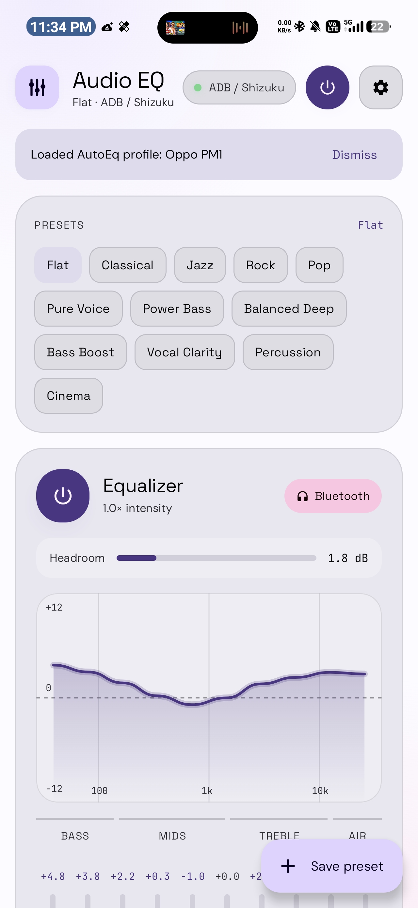
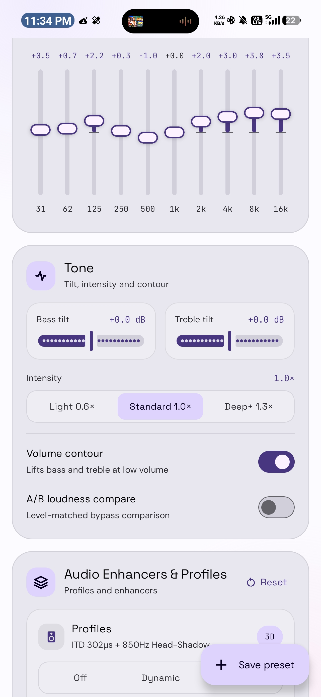
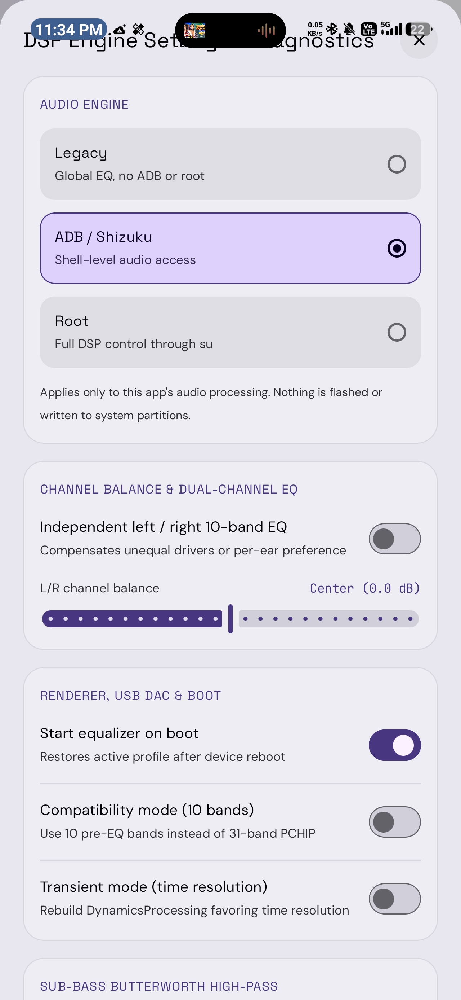

# Audio EQ

A modern, system-wide Android audio equalizer built with **Kotlin** and **Jetpack Compose**, featuring Material Design 3 and dynamic Monet theming. It delivers rich sound customization, headphone calibration, and acoustic profiles without requiring root or system file modifications.

  
  
  

---

## Key Features

### 1. Dual Independent Power Controls
* **Master Power Button**: Located in the top header, globally turns all equalizer and audio effects on or off.
* **Equalizer Toggle**: Located on the Equalizer card, toggles only the 10-band equalizer and presets, allowing Tone knobs and Audio Enhancers to continue working independently.

### 2. 10-Band Graphic Equalizer
* Clean, fluid vertical sliders across 10 octave bands: `31 Hz`, `62 Hz`, `125 Hz`, `250 Hz`, `500 Hz`, `1 kHz`, `2 kHz`, `4 kHz`, `8 kHz`, and `16 kHz`.
* Frequency bands grouped into intuitive sections: **Bass**, **Mids**, **Treble**, and **Air**.
* Overall **Intensity Slider** (`50%` to `150%`) to scale the entire curve smoothly with a single touch.

### 3. Built-in Equalizer Presets
* **Standard Presets**: Flat, Balanced Deep, Bass Boost, Vocal Clarity, Percussion Clarity, and Cinema.
* **Genre & Tuning Presets**: Classical, Jazz, Rock, Pop, Pure Voice, and Power Bass.
* **Custom Curves**: Adjust any slider to automatically switch to Custom mode, with one-tap reset.

### 4. Audio Enhancers & Acoustic Profiles
* **Dialogue Enhancer**: Enhances spoken voice clarity, brings dialogue forward, and reduces low-frequency background noise. Includes an adjustable strength slider.
* **Bass Enhancer**: Delivers deep, punchy low-end with virtual bass harmonic synthesis. Includes a dedicated boost slider that amplifies bass without lowering or suppressing overall volume.
* **Intelligent Equalizer (IEQ)**: Dynamic spectral enhancement with four selectable styles:
  * **Detailed**: Open and bright soundstage.
  * **Balanced**: Natural, full-bodied audio balance.
  * **Warm**: Smooth, rich low-mid response.
  * **Custom**: User-tunable target response.
* **Sound Profiles**:
  * **Dynamic**: Energetic tuning with enhanced sub-bass and airy highs.
  * **Balanced**: Smooth, neutral tuning for extended listening.
  * **3D**: Binaural spatial audio with wide acoustic imaging.
  * **Live Music**: Realistic concert-hall acoustics, early reflections, and natural stage presence.

### 5. AutoEq Headphone & IEM Calibration
* Integrated database of thousands of headphone and IEM measurement corrections from the AutoEq project.
* Search and apply calibrated profiles for popular models (Sony, Sennheiser, Apple, Samsung, Audio-Technica, Moondrop, Beyerdynamic, and more).
* Adjustable correction strength and optional full-range boost modes.

### 6. Per-Device Profile Memory
* Automatically detects the active audio route: **Built-in Speaker**, **Wired Headphones**, **Bluetooth Audio**, or **USB DAC**.
* Automatically remembers and restores unique settings, presets, enhancements, and tone levels for each connected device.

### 7. Sound Customization Tools
* **Tone Controls**: Dedicated Bass and Treble tilt adjustment knobs.
* **Channel Balance & Independent L/R EQ**: Adjust Left/Right stereo balance or fine-tune individual equalizer curves for each ear.
* **Personal Hearing Test**: Interactive hearing threshold test across 6 frequencies to create a personalized hearing compensation profile.
* **Night Mode**: Compresses loud dynamic peaks for comfortable listening at lower volume levels.
* **A/B & ABX Comparison**: Fast instant comparison between processed audio and flat bypass, including a blind ABX test mode.
* **USB DAC Bit-Perfect Mode**: Direct bit-perfect playback switch for external USB DACs on supported Android versions.

### 8. Operating Modes
* **Standard (Non-Root)**: Hooks into active media playback sessions dynamically (Spotify, YouTube Music, local players, etc.) using Android's native audio effects system. No root or special permissions required.
* **ADB / Shizuku Mode**: Discovers background audio sessions and reads active Bluetooth codec details without root access.
* **Root Mode**: Optional helper mode for global audio capture across all apps.

---

## Credits & Acknowledgements

* **[Shizuku](https://shizuku.rikka.app/)** by **[Rikka](https://github.com/RikkaApps/Shizuku)** — Enables non-root system-level session discovery and management through user-authorized elevated APIs.
* **[AutoEq](https://github.com/jaakkopasanen/AutoEq)** by **[Jaakko Pasanen](https://github.com/jaakkopasanen)** — The comprehensive open-source headphone calibration dataset and equalization profiles.

---

## License

This project is licensed under the **GNU General Public License v3.0** (GPL-3.0) — see the [LICENSE](LICENSE) file for details.
